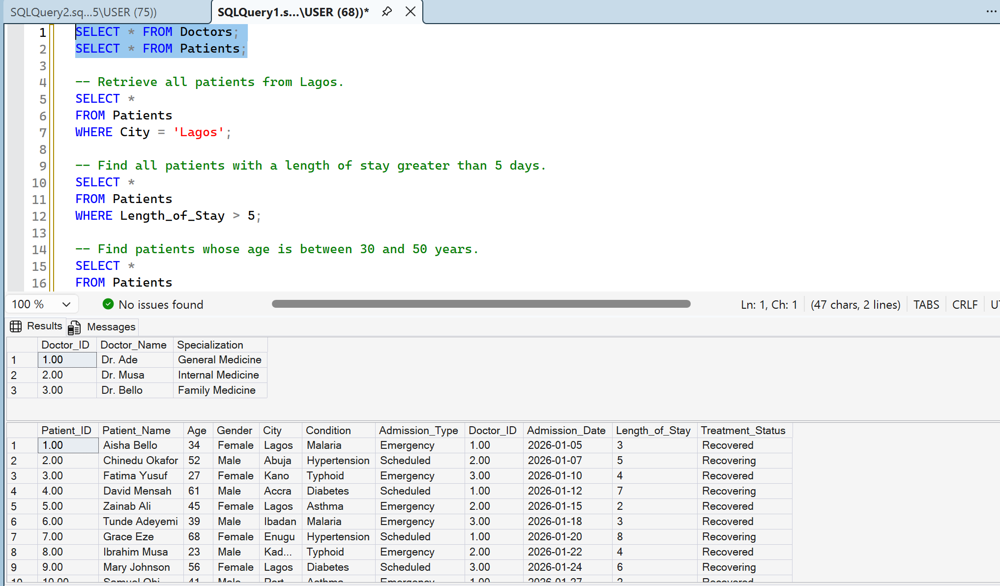
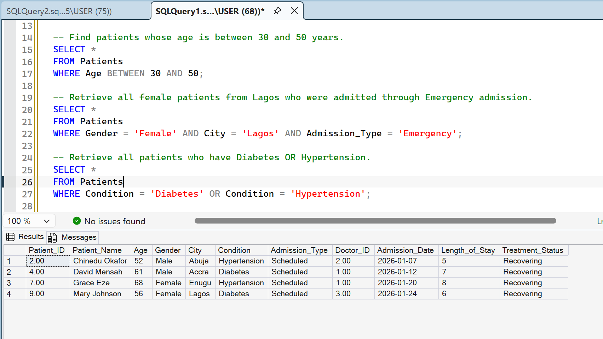
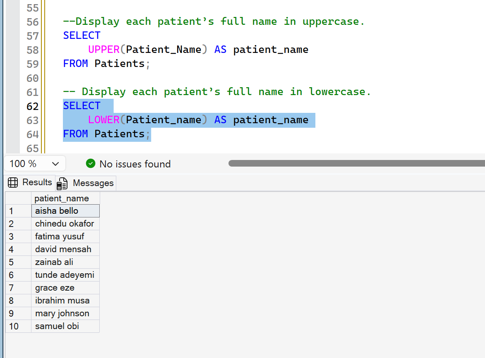
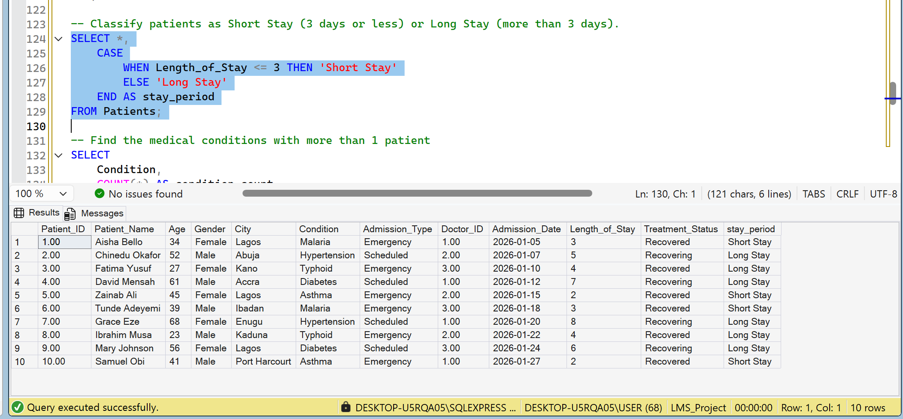
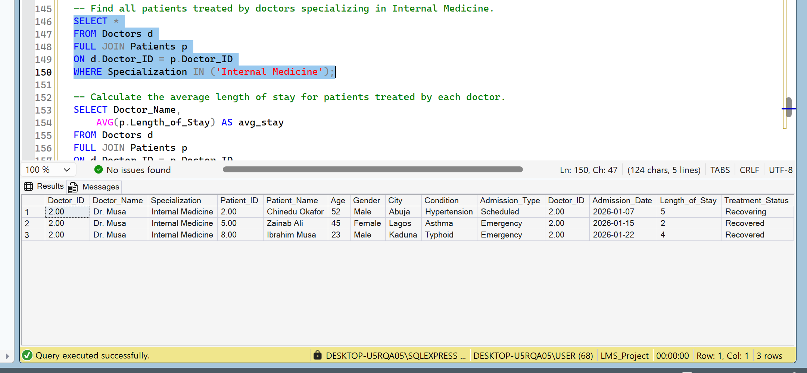
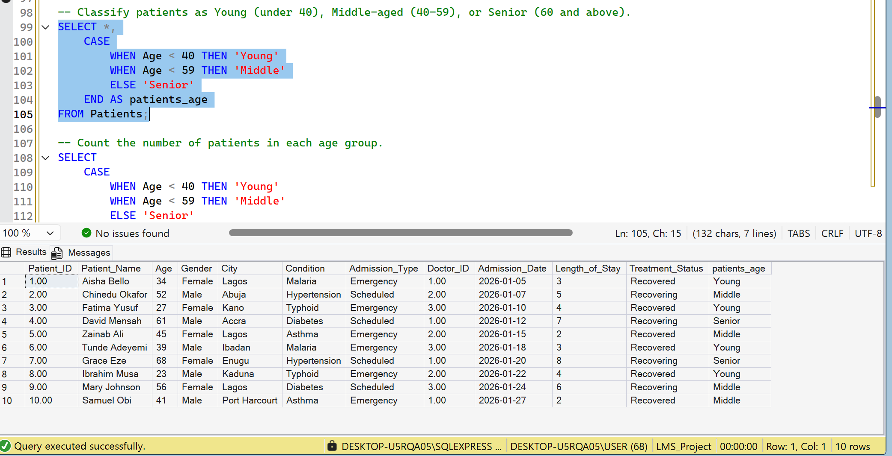

# Healthcare Data Analysis | SQL Server

**A Relational Database Analysis of Patient Demographics, Medical Conditions, Hospital Admissions and Doctor Performance**

## Executive Summary

This project applies SQL-based analytical techniques to a healthcare database to examine patient demographics, admission characteristics, medical conditions, hospital stay patterns, and doctor-patient relationships.

Using Microsoft SQL Server, I conducted structured data exploration across two relational datasets: Patients and Doctors. The analysis involved developing queries to investigate specific healthcare-related questions, derive additional analytical classifications, aggregate patient records, and integrate information across related tables.

The objective was to demonstrate how structured database querying can support data investigation, improve information accessibility, and provide a foundation for evidence-based operational analysis.

## Analytical Context

Healthcare databases contain interconnected information that can provide valuable insights into patient distribution, admission patterns, treatment records, and healthcare personnel.

However, extracting meaningful information requires more than retrieving individual records. It involves understanding the structure of the database, identifying relevant variables, establishing relationships between datasets, and applying appropriate analytical techniques.

This project addresses these requirements through a series of SQL investigations designed around patient-level and doctor-level information.

## Data Architecture

The analysis uses two relational tables:

**Patients**

Contains patient-level records, including demographic information, medical conditions, admission details, length of hospital stay, and treatment status.

Key fields:
- Patient_ID
- Patient_Name
- Age
- Gender
- City
- Condition
- Admission_Type
- Doctor_ID
- Admission_Date
- Length_of_Stay
- Treatment_Status

**Doctors**

Contains information about medical personnel, including their identification numbers, names, and areas of specialisation.

Key fields:
- Doctor_ID
- Doctor_Name
- Specialization

**Data relationship:** The `Doctor_ID` field provides the relational link between the two tables, enabling integrated analysis of patient records and doctor specialisations.

## Analytical Methodology

The project was approached through five major analytical dimensions.

### 1. Patient Demographics and Population Segmentation

The first area of investigation focused on understanding patient characteristics and developing meaningful demographic classifications.

SQL filtering and conditional expressions were applied to:

- Isolate patients based on geographical location.
- Examine patients within specified age ranges.
- Identify gender-specific patient groups.
- Segment the patient population into Young, Middle-aged, and Senior categories.

The `CASE` expression was used to derive age classifications from the existing age variable, creating an additional dimension for demographic analysis.

### 2. Medical Conditions and Admission Analysis

The second dimension examined the distribution of patients across medical conditions and admission categories.

The analysis investigated:

- Patients diagnosed with Diabetes and Hypertension.
- Patients admitted through emergency services.
- Female patients from Lagos admitted through emergency services.
- Medical conditions appearing across multiple patient records.

Logical operators, conditional filtering, aggregate functions, and grouping techniques were applied to retrieve and summarise the relevant records.

### 3. Hospital Stay and Treatment Analysis

Patient length of stay was examined to understand the distribution of hospital admission durations.

A derived classification was created using the `CASE` expression:

- **Short Stay:** Three days or fewer.
- **Long Stay:** More than three days.

The analysis also incorporated treatment status and investigated the average length of hospital stay associated with individual doctors.

This approach demonstrates how SQL can transform raw operational fields into structured analytical variables.

### 4. Relational Data Integration

The Patients and Doctors tables were integrated using SQL joins to establish connections between patient records and medical personnel.

A `FULL JOIN` was implemented using `Doctor_ID` as the common relational key.

This enabled the investigation of:

- Patient-doctor associations.
- Doctor specialisations.
- Patients managed by specialists in Internal Medicine.
- Doctor-level patient stay information.

The integration of both datasets provided a broader analytical view than examining either table independently.

### 5. Data Transformation and Aggregation

SQL functions were applied to manipulate, classify, and summarise the available records.

The techniques included:

| Technique | Analytical Application |
|---|---|
| SELECT | Extracting relevant database records |
| WHERE | Applying analytical filters |
| AND / OR | Combining multiple conditions |
| BETWEEN | Defining numerical ranges |
| IN | Filtering against specified categories |
| UPPER() / LOWER() | Text transformation |
| CASE | Creating derived classifications |
| COUNT() | Measuring record frequency |
| AVG() | Calculating average hospital stay |
| GROUP BY | Aggregating records by category |
| HAVING | Filtering aggregated results |
| FULL JOIN | Integrating relational datasets |

## Analytical Findings

The executed queries provided several observations from the available dataset:

**Patient Demographics:** The analysis successfully classified patients into age segments, distinguishing younger, middle-aged, and senior patients. It also enabled targeted extraction based on gender, age, and geographical location.

**Admission Duration:** Patients were differentiated into short-stay and long-stay categories, providing a structured basis for examining hospitalisation duration.

**Medical Conditions:** Conditional filtering identified patients with specific medical conditions, while aggregation queries were designed to examine the frequency of recorded conditions.

**Doctor Specialisation:** The relational analysis identified three patients associated with the doctor specialising in Internal Medicine in the displayed query results.

**Data Integration:** Joining the two tables enabled patient-level information to be examined alongside doctors' names and specialisations.

These findings demonstrate the analytical value of combining conditional queries, derived classifications, aggregation, and relational data integration.

## Technical Implementation

The project was developed and executed in Microsoft SQL Server Management Studio (SSMS).

The implementation focused on:

- Structured query development and execution.
- Relational database exploration.
- Conditional data extraction.
- Derived variable creation.
- Aggregate analysis.
- Multi-table data integration.
- Interpretation of query outputs.

## Query Execution and Analytical Evidence

The following screenshots document selected stages of the analysis, including SQL implementation and corresponding execution outputs.

**Database Exploration and Initial Data Retrieval**

**Conditional Filtering and Patient Segmentation**

**Text Transformation and Standardisation**

**Derived Variables and Hospital Stay Classification**

**Relational Integration of Patient and Doctor Records**

**Demographic Segmentation Using Conditional Logic**

## Analytical Value

The project demonstrates the application of SQL in converting structured healthcare records into information that can support further investigation.

Its analytical value lies in the ability to:

- Retrieve specific patient populations based on defined criteria.
- Generate additional analytical variables from existing data.
- Examine the distribution of patient characteristics and medical conditions.
- Summarise operational records using aggregate functions.
- Integrate related datasets to investigate relationships between patients and healthcare personnel.
- Develop query-based evidence to address defined analytical questions.

## Conclusion

This project demonstrates a practical application of SQL in relational healthcare data analysis, with emphasis on structured problem investigation, data transformation, aggregation, and relational integration.

It reflects an analytical approach that moves beyond basic data retrieval to examining relationships within datasets, deriving meaningful classifications, and producing query outputs that address specific information requirements.

The work also establishes a foundation for more advanced healthcare analytics, including patient admission trend analysis, treatment outcome assessment, resource utilisation, and operational performance monitoring..

---

**Project Domain:** Healthcare Analytics  
**Project Focus:** Relational Database Analysis and SQL Problem-Solving  
**Technology:** Microsoft SQL Server | SQL Server Management Studio  
**Author:** Olamide Olowe# healthcare-sql-data-analysis
